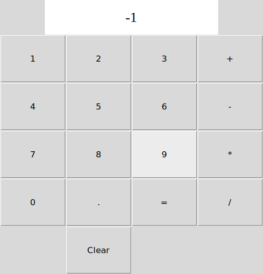
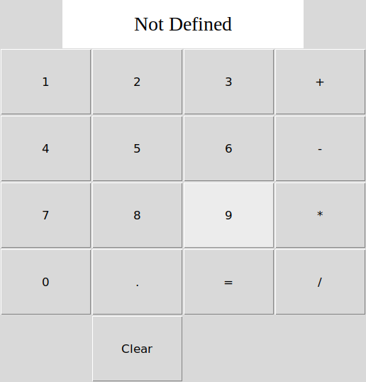
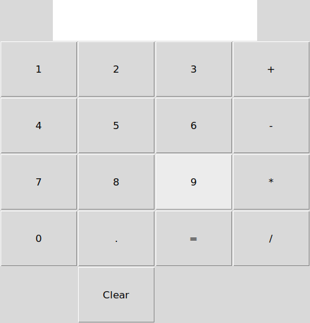

# Calculator: GUI run

Run 2026-11-05 12:48 UTC. `calculator.py` was started for real (its own window, on a virtual screen) and its buttons were pressed one by one.

**10 of 10 checks passed.**

## The window, pressing 12 + 34 = and more

## What each button sequence showed

| Buttons pressed | Display should show | Display showed | Result | Window after |
|---|---|---|---|---|
| 12+34= | 46 | 46 | ✅ pass |  |
| Clear, 7×8= | 56 | 56 | ✅ pass |  |
| Clear, 10÷4= | 2.5 | 2.5 | ✅ pass |  |
| Clear, 1.5+2.25= | 3.75 | 3.75 | ✅ pass |  |
| Clear, 100+5= | 105 | 105 | ✅ pass |  |
| Clear, 2+3=×4= | 20 | 20 | ✅ pass |  |
| Clear, 9-10= | -1 | -1 | ✅ pass |  |
| Clear, 1÷0= | Not Defined | Not Defined | ✅ pass |  |
| Clear, 5+= | Syntax Error | Syntax Error | ✅ pass |  |
| Clear | (empty) | (empty) | ✅ pass |  |

Source: [`calculator.py`](../calculator.py) · runner: [`gui_demo.py`](../gui_demo.py) · workflow: [`run.yml`](../.github/workflows/run.yml)
